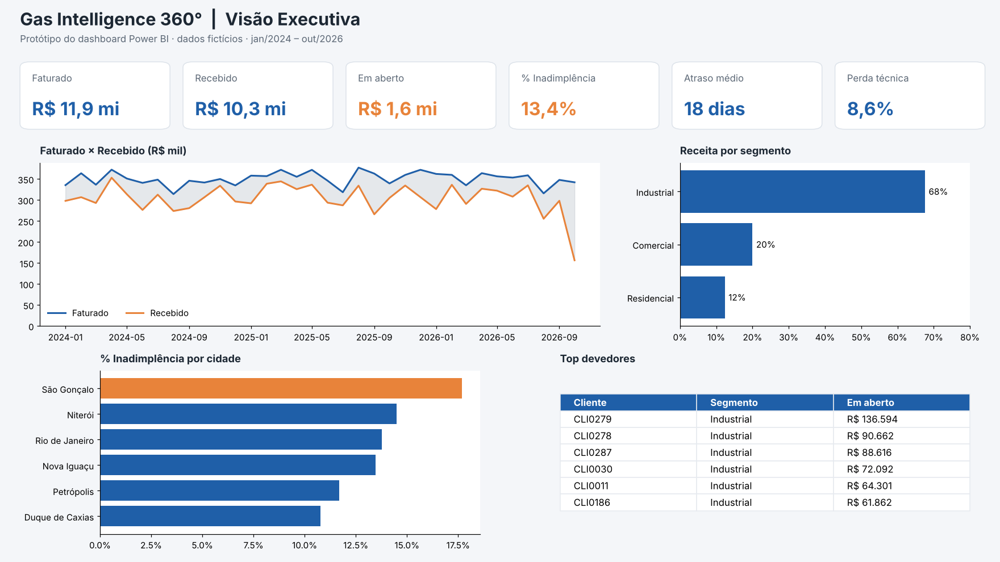

# Etapa 4: Dashboard no Power BI

*Protótipo da página "Visão Executiva", gerado a partir dos mesmos dados do DW.*

## Arquivos desta pasta

| Arquivo | Uso |
|---|---|
| [`medidas.dax`](medidas.dax) | Todas as medidas DAX do relatório, prontas para colar |
| [`tema_gas360.json`](tema_gas360.json) | Tema de cores (Exibir › Temas › Procurar temas) |
| `Gas_Intelligence_360.pbix` | Arquivo do Power BI *(adicionar após montar o relatório)* |

## Passo a passo

### 1. Importar o DW
**Obter dados › Texto/CSV** e importe os 7 arquivos de [`data/dw/`](../data/dw):
`dim_tempo`, `dim_cidade`, `dim_cliente`, `dim_contrato`, `fato_faturamento`, `fato_operacao`, `fato_ocorrencia`.

No Power Query, confira os tipos: colunas `data_*` como **Data**; `valor_*`, `volume_*`, `perda_*` e `custo_*` como **Número decimal**.

### 2. Modelagem (modelo estrela)

| De (muitos) | Para (um) | Ativa? |
|---|---|---|
| `fato_faturamento[sk_tempo]` | `dim_tempo[sk_tempo]` | ✅ |
| `fato_faturamento[sk_cidade]` | `dim_cidade[sk_cidade]` | ✅ |
| `fato_faturamento[sk_cliente]` | `dim_cliente[sk_cliente]` | ✅ |
| `fato_faturamento[sk_contrato]` | `dim_contrato[sk_contrato]` | ✅ |
| `fato_operacao[sk_tempo]` | `dim_tempo[sk_tempo]` | ✅ |
| `fato_operacao[sk_cidade]` | `dim_cidade[sk_cidade]` | ✅ |
| `fato_ocorrencia[sk_*]` | dimensões correspondentes | ✅ |
| `dim_contrato[sk_cliente]` | `dim_cliente[sk_cliente]` | ❌ inativa |
| `dim_cliente[sk_cidade]` | `dim_cidade[sk_cidade]` | ❌ inativa |

> As duas últimas ficam **inativas** para evitar caminhos ambíguos: as fatos já carregam todas as chaves.

Depois, marque `dim_tempo` como **tabela de datas** usando `data_inicio_mes` (necessário para `DATEADD` e `TOTALYTD`).

### 3. Medidas
Crie uma tabela vazia `_Medidas` e cole as medidas de [`medidas.dax`](medidas.dax).

### 4. Páginas do relatório

**Página 1: Visão Executiva** (protótipo acima)
- Cartões: Faturado, Recebido, Em Aberto, % Inadimplência, Atraso Médio, % Perda Técnica
- Linhas: Faturado × Recebido por `dim_tempo[data_inicio_mes]`
- Barras: `% Receita do Total` por `dim_cliente[segmento]`
- Barras: `% Inadimplência` por `dim_cidade[cidade]`
- Tabela: top devedores (`cliente_id`, `segmento`, `Em Aberto`), filtro Top N = 10

**Página 2: Cobrança**
- Rosca: `Faturas` por `status_pagamento`
- Colunas agrupadas: `Atraso Médio (dias)` e `% Pago no Prazo` por `meio_pagamento`
- Matriz: cidade × trimestre com `% Inadimplência` (formatação condicional em escala de cores)

**Página 3: Operação**
- Linhas: `% Perda Técnica` por mês
- Barras: `% Perda Técnica` e `Custo por m³` por cidade
- Matriz: `tipo_ocorrencia` × `severidade` com `Ocorrências`; cartão de `Ocorrências Abertas`

**Segmentações** em todas as páginas: ano, cidade, segmento, plano.

### 5. Publicar
Salve como `Gas_Intelligence_360.pbix` nesta pasta, tire prints de cada página e adicione ao README principal.
Se tiver conta, publique no Power BI Service e coloque o link aqui.
