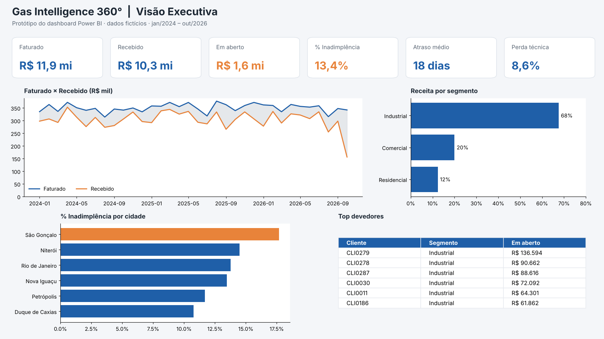
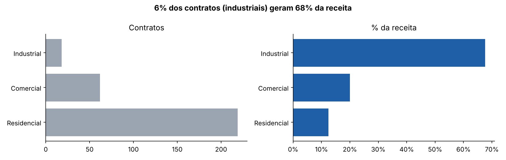
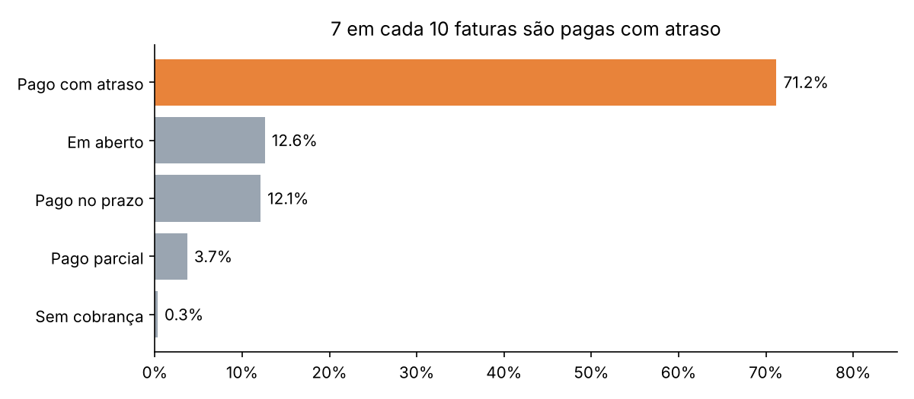
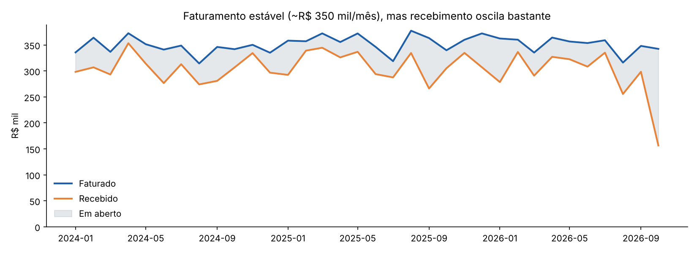
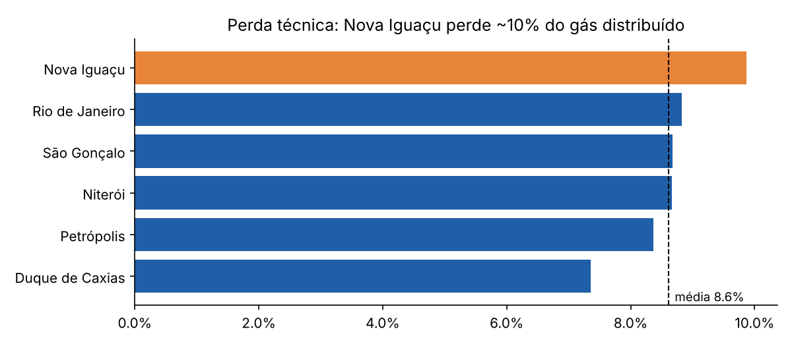
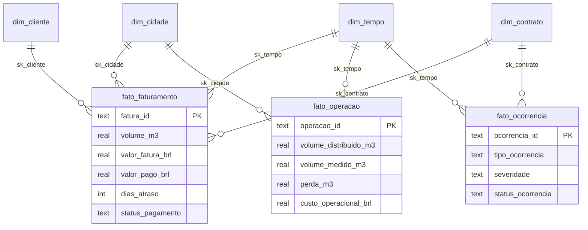

# ⛽ Gas Intelligence 360°

**Projeto de dados ponta a ponta para uma distribuidora de gás fictícia:** da importação das bases brutas no Google Colab até um Data Warehouse em modelo estrela, análises em SQL e um dashboard no Power BI.




> Dados 100% sintéticos, criados para fins de estudo. Não representam nenhuma empresa real.

---

## 🎯 Problema de negócio

A diretoria da distribuidora quer responder:
1. Quanto faturamos e quanto realmente recebemos?
2. Onde está a inadimplência, e quem são os maiores devedores?
3. De onde vem a receita?
4. Quanto gás estamos perdendo entre a distribuição e o medidor?
5. Os dados dos sistemas são confiáveis?

## 🧭 Trilha do projeto

| Etapa | O que foi feito | Arquivo | Abrir no Colab |
|---|---|---|---|
| **1. Importação e tratamento** | Diagnóstico de qualidade, 9 regras de limpeza documentadas, quarentena e trilha de auditoria | [notebook](01_colab/01_importacao_e_tratamento.ipynb) | [](https://colab.research.google.com/github/Brithysetubal/gas-intelligence-360/blob/main/01_colab/01_importacao_e_tratamento.ipynb) |
| **2. Data Warehouse** | Modelo estrela com 4 dimensões e 3 fatos, chaves substitutas, membro desconhecido e testes de integridade | [notebook](02_data_warehouse/02_construcao_dw.ipynb) · [DDL](02_data_warehouse/ddl_modelo_estrela.sql) | [](https://colab.research.google.com/github/Brithysetubal/gas-intelligence-360/blob/main/02_data_warehouse/02_construcao_dw.ipynb) |
| **3. Análises em SQL** | 12 consultas de negócio com CTEs e funções de janela | [notebook](03_sql/03_analises_sql.ipynb) · [SQL](03_sql/analises.sql) | [](https://colab.research.google.com/github/Brithysetubal/gas-intelligence-360/blob/main/03_sql/03_analises_sql.ipynb) |
| **4. Dashboard Power BI** | Modelagem, 26 medidas DAX, tema e layout de 3 páginas | [guia](04_power_bi/README.md) · [DAX](04_power_bi/medidas.dax) | — |

---

## 💡 Principais insights

| | Insight | Recomendação |
|---|---|---|
| 💰 | **R$ 1,6 mi em aberto (13,5% do faturado)** em 34 meses | Régua de cobrança por faixa de atraso |
| ⏰ | **71% das faturas são pagas com atraso** (média de 18 dias), igual em Pix e boleto | Testar datas de vencimento flexíveis: o meio de pagamento não é a causa |
| 🏭 | **18 clientes industriais (6%) geram 68% da receita**; 18% dos clientes formam 80% do faturamento (curva ABC) | Gestão de contas dedicada para a classe A |
| 🎯 | **Os 10 maiores devedores são industriais e somam R$ 745 mil** (46% do valor em aberto) | Priorizar a cobrança nesses 10 contratos |
| 📍 | **São Gonçalo tem a maior inadimplência** (17,7%), 7 p.p. acima de Duque de Caxias | Investigar perfil de clientes da região |
| 🔧 | **8,6% do gás distribuído é perdido**; Nova Iguaçu chega a 9,9%. A perda caiu de 9,1% (2024) para 8,1% (2026) | Manter o plano de manutenção, com foco em Nova Iguaçu |
| ⚠️ | **Vazamentos** são a ocorrência mais comum e a com mais chamados em aberto (12,5%) | SLA prioritário para vazamentos |

<p align="center">
  
  
</p>
<p align="center">
  
  
</p>

---

## 🧹 Qualidade de dados

A base bruta veio com problemas propositais. Nenhum arquivo bruto foi alterado: o tratamento gera cópias em `data/processed/` e um [log de auditoria](data/processed/log_qualidade.csv).

| Problema encontrado | Linhas | Tratamento |
|---|---:|---|
| Linhas duplicadas (clientes, consumo, faturas) | 3 | Removidas |
| Leituras com volume negativo | 34 | Volume invalidado e sinalizado |
| Faturas sem valor | 68 | Recalculadas com a tarifa do segmento (descoberta nos dados: R$ 6,20 / 5,40 / 4,30 por m³) |
| Cliente sem segmento / sem cidade | 2 | Segmento inferido pela tarifa; cidade = "Não informado" |
| Contrato com cliente inexistente (CLI9999) | 1 | Mantido e ligado ao membro "Cliente desconhecido" do DW |
| Pagamentos com data futura, valor zero ou fatura inexistente | 232 | Movidos para [quarentena](data/processed/pagamentos_quarentena.csv) |

---

## 🗄️ Modelo do Data Warehouse



O DW passa por **6 testes automáticos de integridade** e por uma reconciliação de valores com a base tratada (R$ 11.927.488,34 nos dois lados).

---

## 📁 Estrutura

```
gas-intelligence-360/
├── data/
│   ├── raw/              # bases brutas originais (CSV + Excel)
│   ├── processed/        # bases tratadas, quarentena e log de qualidade
│   └── dw/               # gas_dw.db (SQLite) + tabelas exportadas para o Power BI
├── 01_colab/             # Etapa 1: importação e tratamento
├── 02_data_warehouse/    # Etapa 2: DDL e carga do modelo estrela
├── 03_sql/               # Etapa 3: consultas analíticas
├── 04_power_bi/          # Etapa 4: medidas DAX, tema e guia do dashboard
└── docs/                 # dicionário de dados e imagens
```

## ▶️ Como reproduzir

**No Google Colab:** clique nos botões "Open in Colab" da tabela acima e execute os notebooks em ordem (1 → 2 → 3). Cada notebook clona o repositório automaticamente.

**Localmente:**
```bash
git clone https://github.com/Brithysetubal/gas-intelligence-360.git
cd gas-intelligence-360
pip install -r requirements.txt
jupyter notebook
```

## 🛠️ Ferramentas

Python (pandas, NumPy, Matplotlib) · Google Colab · SQL (SQLite) · Modelagem dimensional (Kimball) · Power BI · DAX

---

👩‍💻 **Bianca** · [GitHub](https://github.com/Brithysetubal)
